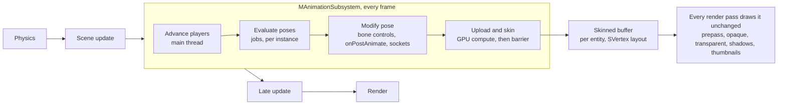

# Meteor Engine - Animation System v1 Design

## Overview

v1 adds skinned characters that play and crossfade clips from code or Lua, with bones evaluated on the CPU through `MJobSystem` and skinning done once per frame by a GPU compute shader. State machines come later and plug into the same playback core.

**In v1**

- `MSkeletalMeshAsset` and `MAnimClipAsset`, picked by one model importer, with a per-file `importAs` setting
- `MSkeletalMeshEntity`, a spatial entity alongside `MStaticMeshEntity`
- `MAnimationSubsystem`, which evaluates poses in parallel jobs, with off-screen culling modes
- Compute-shader skinning that outputs the existing `SVertex` layout, so no render stage or material shader changes, with a variable number of bone influences per vertex
- `playClip(name, blendTime)` with crossfades, exposed to Lua
- Clips from other files, bound to a skeleton by exact bone name
- `onPostAnimate`, a C++ and Lua hook for editing the pose before skinning
- `MBoneSocketEntity` (a bone drives an entity) and `MBoneControlEntity` (an entity drives a bone, with `lookAt`)
- Editor support: import settings, Available Clips table, extra animation sources

**Not in v1:** state machines, root motion, additive blending and bone masks, IK, retargeting beyond name matching, clip compression, morph targets, animation events, animation LOD.

## Engine constraints

The design is shaped by how Meteor works today:

| Constraint | Where | Consequence for animation |
| --- | --- | --- |
| One asset per path; the first importer whose `canImport(ext)` succeeds wins | `MAssetManager::loadAsset` | One FBX is either a mesh or a clip asset. No sub-assets, so embedded clips can't have their own GUIDs. |
| A render item is a VAO + EBO + transform; each stage binds its own shader | `SRenderItem`, prepass / opaque / shadow / transparent stages | If skinning outputs a normal VAO, every stage draws skinned meshes unchanged. |
| Vertex inputs are fixed at locations 0–2 (position, normal, UV) | `meteor_vertex_utils.glsl`, `SVertex` | Vertex-shader skinning would need variants of every material, prepass and shadow shader. |
| OpenGL 4.6, SSBOs already in use | `windowing.cpp`, lighting / opaque stages | Compute shaders and SSBOs are available. |
| Applications drive the frame: physics, then `update`, then `lateUpdate`, then render | `MPlayerApplication`, editor `simulation_manager` | Animation is called explicitly between `update` and `lateUpdate`. |
| Jobs must not touch Lua, the scene, the asset manager or GL; tasks should be coarse | `job_system.h` | Clip lookups happen on the main thread; jobs only run pose maths on their own instances. |

## Import pipeline

One `MModelAssetImporter` replaces `MStaticMeshAssetImporter`'s extension check for gltf, glb, fbx and obj. It reads `importAs` from the `.meta` file and creates the matching asset class.

```xml
<meshImport>
  <importAs>Auto</importAs>   <!-- Auto | StaticMesh | SkeletalMesh | AnimationOnly -->
  <scaleFactor>0.01</scaleFactor>
  <pivot>FileOrigin</pivot>
  <maxBoneInfluences>8</maxBoneInfluences>   <!-- 0 = no limit -->
  <sampleRate>30</sampleRate>
</meshImport>
```

**Auto detection** runs once, on first import:

| Scene contents | Result |
| --- | --- |
| Meshes with bones | `MSkeletalMeshAsset` |
| No meshes, has animations | `MAnimClipAsset` |
| Anything else | `MStaticMeshAsset` |

The detected value is written back into the meta file, so later loads skip detection and the inspector shows it as a dropdown. Choosing StaticMesh for a rigged file imports it in bind pose with the bones ignored.

**Changing `importAs` changes the C++ class.** A reload destroys and recreates the asset. A `TAssetRef<MStaticMeshAsset>` pointing at a file that is now skeletal must resolve to null and log a warning, never cast. The editor can offer to swap the affected entities.

**Rules for skeletal import**

- Don't bake node transforms into skinned vertices; they stay in bind space.
- `scaleFactor` applies to vertex positions, bone translations, inverse-bind matrices and clip translation keys alike.
- `pivot` becomes a root offset rather than a vertex shift.
- Set `AI_CONFIG_IMPORT_FBX_PRESERVE_PIVOTS = false` to avoid `$AssimpFbx$` helper bones.
- Keep bone names exactly as authored; no prefix stripping or case folding.
- Sort each vertex's influences by weight, drop any beyond `maxBoneInfluences` (8 by default, 0 = keep all), then renormalize.
- Use `aiProcess_CalcTangentSpace` if tangents are added to `SVertex` (see milestones).

**Resampling.** Every track is baked to evenly spaced keys at `sampleRate`, so sampling is `i = t × rate` plus a blend between two keys, with no search. That trades memory for simpler, cache-friendly job code; compression comes later.

## Data types

Clips are plain data shared by both asset types. A clip binds to any skeleton by bone name, so animation-only files work without a shared skeleton asset.

| Type | Kind | Holds |
| --- | --- | --- |
| `SSkeleton` | Data, owned by the mesh asset in v1 | Bones in parent-first order: name, parent index, inverse-bind matrix, bind pose position / rotation / scale |
| `SBoneInfluence` | Data | `uint joint` + `float weight`; a vertex has a variable number of these |
| `MSkeletalMesh` | GPU mesh | Shared, read-only buffers: bind-pose vertices, influence offsets, packed influences, indices |
| `MAnimClip` | Data | Name, duration in seconds, sample rate, one track per bone keyed by bone name |
| `MSkeletalMeshAsset` | Asset | Meshes, the skeleton and its embedded clips |
| `MAnimClipAsset` | Asset | Every clip (take) in an animation-only file |
| `IAnimationClipSource` | Interface | `getClips()`, implemented by both asset types |

```cpp
class IAnimationClipSource {
public:
    virtual ~IAnimationClipSource() = default;
    virtual const std::vector<MAnimClip*>& getClips() const = 0;
};
```

**Binding by exact bone name.** The first time a clip is used on a skeleton, the engine builds a table mapping each clip track to a skeleton bone index, cached per (clip, skeleton) pair. Names must match exactly, so Mixamo characters and Mixamo clips match as exported. Tracks with no matching bone are ignored, and bones with no track stay in bind pose. All lookups go through one function, `resolveBoneIndex(skeleton, trackName)`, so v2 can add mapping without touching anything else.

**v2: retarget asset.** `MRetargetAsset` holds a source skeleton, a target skeleton and a name-to-name bone map, pre-filled by exact name and then by name with the prefix stripped (for `mixamorig1:` style variants), and fixed by hand. Each animation source gets an optional retarget slot. A name map only works when rest poses match; rest-pose correction (A-pose vs T-pose, different bone orientations) comes after it.

**Why an interface.** A file containing a mesh *and* animations imports as a skeletal mesh, but its clips should still be usable on other characters. Entity code only sees `IAnimationClipSource`, so either asset type can supply clips.

## MSkeletalMeshEntity

The entity mirrors `MStaticMeshEntity` and adds a list of animation sources. It builds one clip table from its mesh plus those sources.

**Saved fields**

| Field | Type | Notes |
| --- | --- | --- |
| `meshAsset` | `TAssetRef<MSkeletalMeshAsset>` | As on the static mesh entity |
| material slots | list | Shared code with `MStaticMeshEntity` (see below) |
| `castsShadow` | bool | |
| `animationSources` | ordered list of refs to an `MAnimClipAsset` or `MSkeletalMeshAsset` | Order matters for name conflicts |
| `defaultClip` | clip name | Kept even if the clip disappears; shown in red |
| `playOnStart`, `loop`, `speed` | bool, bool, float | |
| `cullingMode` | `AdvanceTimeOnly` / `Pause` / `AlwaysAnimate` | What happens off-screen; default `AdvanceTimeOnly` (see MAnimationSubsystem) |

Embedded clips are **never saved**. They are rebuilt from the mesh asset whenever it resolves, the same way material slots resize to the mesh count in `onDeserialise`. A re-exported FBX with a new clip then shows up without editing the scene.

**Pull out the material-slot code first.** Slot serialization, the legacy formats and resizing make up most of `staticmeshentity.cpp`. Move them into a shared helper or an `MMeshEntityBase` before writing the second entity.

**Building the clip table** (main thread, whenever the mesh or sources change)

1. Add the mesh asset's own clips.
2. Add each source's clips in list order. A later clip with the same name overrides the earlier one.
3. Skip duplicate sources, including the mesh's own asset added as a source.
4. Build or fetch the bone-name table for each clip and work out its status.

**Clip status**

| Status | When | Effect |
| --- | --- | --- |
| Available | All bones matched | Playable |
| Warning | Some bones matched (e.g. 52/55) | Playable. Normal for upper-body clips or skeletons with extra socket, IK or face bones. |
| Unavailable | No bones matched, or the skeleton's root bone has no track | Greyed out with the reason; not in Default Clip or `getClipNames()`; `playClip` logs the reason |
| Overridden | A later source has a clip with the same name | Greyed out, shows which source won |

**Bounds.** Camera and shadow culling both use `SRenderItem::bounds`, and a bind-pose AABB culls raised limbs. Each frame, use the AABB of the joint world positions plus padding; the jobs already compute those positions. While a character is culled its pose stops updating, so keep its last bounds and pad them generously; otherwise it can stay culled when it should come back into view.

**Runtime data lives in the subsystem.** The entity holds a handle into `MAnimationSubsystem`'s instance pool. It registers on enter and unregisters on exit and destruction, like its render queue registration.

## MAnimationSubsystem

The subsystem runs once per frame **between `sceneManager->update` and `lateUpdate`**. A `playClip` from a script's `onUpdate` then takes effect in the same frame, and `lateUpdate` code (cameras, attached weapons) sees this frame's bones. Like physics, `canTick()` stays false and the applications call it directly: `MPlayerApplication` and the editor's `simulation_manager`.



Only the bone matrices cross from CPU to GPU each frame; the skinned buffer they produce is drawn by every pass.

**Each frame**

1. **Main thread:** advance clip times, update crossfade weights, resolve clip pointers and bone tables.
2. **Jobs (`MParallel::forEach` over instances):** sample each active clip, blend, walk bones parent-first to get local and model-space transforms, and compute the joint AABB. Each task writes only its own instance's slice.
3. **Main thread, pose modifiers:** for each evaluated instance, run `IBoneModifier`s in parent-first bone order (bone controls in v1, IK in v2), then call `onPostAnimate(dt)`.
4. **Main thread:** recompute model space and skinning matrices for instances whose bones changed in step 3.
5. **Main thread:** update bone sockets, so they see the edited pose.
6. **Main thread:** upload all skinning matrices with one `glBufferSubData` into a shared bone SSBO (each instance has an offset), dispatch skinning for every visible instance, then issue one barrier (see GPU compute skinning).

Whole-frame order: `onUpdate` → animation → bone modifiers → `onPostAnimate` (pose editable) → sockets → skinning → `onLateUpdate` (pose read-only, final).

Skinning runs **once per frame, not per view**, so the editor's scene view, game view and thumbnails all reuse the result.

**SAnimationPlayer** holds playback state: active entries (clip, time, weight, fade rate), speed and loop flag. It is a plain struct, not part of the entity. `playClip` drives it today; a state machine later becomes another driver of the same struct, with no change to jobs or skinning.

**Crossfades**

- Up to 3 active entries. `playClip` adds an entry whose weight rises from 0 to 1 over `blendTime`; the others fall proportionally.
- Entries at weight 0 are dropped. A fourth crossfade mid-blend drops the oldest.
- Positions and scales blend linearly. Rotations use normalized quaternion blending, with the sign flipped when the dot product is negative.
- `playClip` on the clip already playing is a no-op.

**Off-screen culling**

A character outside the view frustum stops animating by default. Each entity picks a `cullingMode`:

| `cullingMode` | Off-screen behaviour |
| --- | --- |
| `AdvanceTimeOnly` (default) | Clip time and `onClipFinished` keep going; no bone evaluation, modifiers, `onPostAnimate` or skinning |
| `Pause` | Nothing updates; playback resumes where it stopped |
| `AlwaysAnimate` | Full evaluation and skinning, as if visible |

Advancing time costs one float add per character, and it means a character that walks off-screen mid-run doesn't come back frozen on the same frame.

Two exceptions force bone evaluation (not skinning) while culled: a bone socket with `keepUpdatedOffscreen` set, and `AlwaysAnimate`. A character just outside the frustum can still cast a shadow into view; that shadow freezes in v1. Later, "visible" can include being inside a shadow-casting light's volume.

**onPostAnimate**

A C++ virtual on `MSkeletalMeshEntity` and a Lua callback (`SCRIPT_FUNC_POST_ANIMATE = "onPostAnimate"` in `scripting_call_symbols.h`). Like the physics messages, it runs on the entity's own script, and only if that script defines it. It runs after the pose is computed and before skinning, so bone edits show on the mesh the same frame: look-at, aim offsets, simple foot placement.

- Called only for instances evaluated this frame, in a fixed order, on the main thread.
- Whether a script defines `onPostAnimate` is checked once when the script binds, not every frame.
- v1 edits bone **local** transforms only; step 4 re-walks the skeleton for dirty instances.
- Pose writes outside `onPostAnimate` are ignored with a warning, since the next evaluation would overwrite them anyway.

## Bone sockets and bone controls

Both are spatial entities that must be direct children of an `MSkeletalMeshEntity`, and both pick a bone by name from a dropdown of the parent's skeleton. A socket copies a bone's transform onto an entity; a control copies an entity's rotation onto a bone.

**MBoneSocketEntity**

| Field | Type | Notes |
| --- | --- | --- |
| `boneName` | string | Saved by name, so it survives reimports |
| `followPosition` / `followRotation` / `followScale` | bool | Defaults: true, true, false |
| `offset` | position / rotation / scale | Applied after the bone, e.g. to seat a sword in the palm |
| `keepUpdatedOffscreen` | bool | Forces bone evaluation (not skinning) while the character is culled, for gameplay such as hitboxes or muzzle points |

- The socket's local transform is `bone_model × offset`. Its parent is the mesh entity, so no world-space maths is needed.
- Follow flags decompose the bone transform; parts whose flag is off keep the socket's own local value.
- Updated in step 5, before `onLateUpdate`, so anything parented to the socket follows the same frame.

**MBoneControlEntity**

| Field | Type | Notes |
| --- | --- | --- |
| `boneName` | string | Choosing a bone in the editor snaps the control to that bone's bind-pose transform |
| `mode` | `Override` / `Additive` | Override replaces the animated rotation; Additive adds the control's change from its snapped start on top of it |
| `weight` | float 0–1 | Blends between the animated rotation and the control's |
| `maxAngle` | degrees, 0 = no limit | Clamps how far the bone turns from its animated rotation |
| `aimAxis`, `upAxis` | axis | Defaults: the character's forward and up at bind pose, expressed in the bone's frame |
| `turnSpeed` | degrees per second, 0 = instant | Smooths `lookAt` turns |
| `blendTime` | seconds | Fades `weight` in and out on `setLookTarget` / `clearLookTarget` |

- Runs as the first `IBoneModifier`, in parent-first bone order. The bone's new local rotation is `inverse(parentBoneModelRot) × targetModelRot`, using the parent's rotation after any controls on ancestor bones.
- Two controls on the same bone: the last in hierarchy order wins, with an inspector warning.
- Sockets run after controls, so a hat on a turned head follows it.

```cpp
void lookAt(const SVector3& worldTarget);     // aim once this frame
void setLookTarget(MSpatialEntity* target);   // keep tracking an entity
void clearLookTarget();                       // fade back to the animation
bool hasLookTarget() const;
```

`lookAt` turns `aimAxis` toward the target from the bone's last-frame position while keeping `upAxis` upright; `mode`, `weight`, `maxAngle` and `turnSpeed` then apply. With Additive mode and `maxAngle` around 70°, a head look keeps the idle motion and holds at the limit when the target goes behind. The aim maths is a standalone helper, ready for v2 IK.

**IBoneModifier.** Controls are not special-cased in the subsystem. A small interface (`apply(poseInstance)` plus a sort key) runs in step 3; `MBoneControlEntity` is the first implementation, and v2 two-bone IK for legs and hands becomes another.

## GPU compute skinning

A compute shader skins each instance once per frame into its own buffer, laid out exactly as `SVertex`. That buffer sits behind a normal VAO, so the entity submits an ordinary `SRenderItem`. The prepass, opaque, transparent, shadow and thumbnail paths draw it with no new shaders.

**Buffers**

| Buffer | Owner | Access | Contents |
| --- | --- | --- | --- |
| Bind-pose vertices | `MSkeletalMesh` (shared) | read | 8 floats per vertex: position, normal, UV |
| Influence offsets | `MSkeletalMesh` (shared) | read | `vertexCount + 1` uints; vertex v's influences are `[offsets[v], offsets[v+1])` |
| Influences | `MSkeletalMesh` (shared) | read | Packed `{ uint joint; float weight; }`, sorted by weight per vertex |
| Bone matrices | `MAnimationSubsystem` (one for all) | read | Every instance's skinning matrices, uploaded each frame |
| Skinned vertices | Each entity | write, then draw | Same layout as `SVertex`; bound as an SSBO for the dispatch and as `GL_ARRAY_BUFFER` in the entity's VAO |

**Never skin in place.** The source must stay the bind pose; overwriting it would skin already-skinned vertices the next frame.

**Per entity, not per asset.** Two characters sharing a mesh have different poses, so each entity gets its own output buffer and VAO. Input buffers stay shared.

```glsl
#version 460
layout(local_size_x = 64) in;
struct Influence { uint joint; float weight; };
layout(std430, binding = 0) readonly  buffer BindPose   { float bindVerts[]; };   // 8 floats per vertex
layout(std430, binding = 1) readonly  buffer Offsets    { uint offsets[]; };      // vertexCount + 1
layout(std430, binding = 2) readonly  buffer Influences { Influence infl[]; };
layout(std430, binding = 3) readonly  buffer Bones      { mat4 bones[]; };
layout(std430, binding = 4) writeonly buffer Out        { float outVerts[]; };
uniform uint u_vertexCount;
uniform uint u_boneOffset;   // this instance's slice of the bone buffer

void main() {
    uint v = gl_GlobalInvocationID.x;
    if (v >= u_vertexCount) return;
    uint b = v * 8;
    vec4 p = vec4(bindVerts[b], bindVerts[b+1], bindVerts[b+2], 1.0);
    vec3 n = vec3(bindVerts[b+3], bindVerts[b+4], bindVerts[b+5]);
    mat4 m = mat4(0.0);
    for (uint i = offsets[v]; i < offsets[v + 1]; ++i)
        m += infl[i].weight * bones[u_boneOffset + infl[i].joint];
    vec3 sp = (m * p).xyz;
    vec3 sn = normalize(mat3(m) * n);
    outVerts[b]   = sp.x; outVerts[b+1] = sp.y; outVerts[b+2] = sp.z;
    outVerts[b+3] = sn.x; outVerts[b+4] = sn.y; outVerts[b+5] = sn.z;
    outVerts[b+6] = bindVerts[b+6]; outVerts[b+7] = bindVerts[b+7];   // UVs copied through
}
```

The loop length is the vertex's own influence count, so meshes authored for 4 cost the same as a fixed-4 layout; only vertices that really use more pay more. A vertex with no influences (rigid, unskinned parts) should be given one influence on its parent bone at import, so `m` is never zero.

**Things to get right**

- **std430 alignment:** a `vec3` aligns to 16 bytes, but `SVertex` is a packed 32 bytes. Declare vertex buffers as `float[]` and index them by hand.
- **Barrier:** call `glMemoryBarrier(GL_VERTEX_ATTRIB_ARRAY_BARRIER_BIT)` once after all dispatches, before any stage draws.
- **Normals:** `mat3(m) * n` is only correct without non-uniform bone scale. That holds for nearly all character rigs.
- **Tangents:** if added to `SVertex`, skin them with the same `mat3(m)` and update the output stride at the same time.
- **Dispatch overhead:** start with one dispatch per instance, and batch every instance into one dispatch with an offset table if it shows up in profiling.

**CPU fallback.** Put skinning behind `ISkinningBackend`. A second implementation using `MJobSystem` writes the same output buffer, which makes a useful reference when the GPU output looks wrong.

**Expected performance.** These are rough estimates, not measurements: 20 characters × 30k vertices, drawn in about 8 passes (prepass, opaque, 3–4 shadow cascades, point-light faces).

| | CPU skinning (jobs) | Vertex-shader skinning | Compute skinning |
| --- | --- | --- | --- |
| CPU time | ~3–6 ms total, ~0.5–1 ms across 8 cores | ~0 | ~0 |
| Upload per frame | ~19 MB of vertices | ~20 KB of bones | ~20 KB of bones |
| Vertices skinned | 600k on the CPU | ~5M (every pass) | 600k (once) |
| Extra GPU time vs static meshes | upload / sync stalls | ~0.2–0.5 ms | ~0.1–0.2 ms |
| Extra VRAM | - | - | ~19 MB of output buffers |

Against CPU skinning, compute is a large win beyond a few characters. Against vertex-shader skinning, the frame-time gain is small and grows with shadow passes; the main gain is not needing skinned variants of every shader. Measure with a `GL_TIME_ELAPSED` timer query around the dispatches, reported through the profiler.

## Scripting API

Playback is exposed on `MSkeletalMeshEntity` with `SCRIPT_BIND_FUNC()` and forwards to its `SAnimationPlayer`.

```cpp
bool playClip(const SString& name, float blendTime = 0.2f, bool loop = true); // no-op if already playing
void stop(float blendTime = 0.2f);
void setSpeed(float speed);
bool isPlaying() const;
SString getCurrentClip() const;            // the entry with the highest weight
float getNormalizedTime() const;
void setNormalizedTime(float t);
bool hasClip(const SString& name) const;   // available clips only
std::vector<SString> getClipNames() const; // available clips only
SMatrix4 getBoneWorldTransform(const SString& boneName) const; // for sockets, valid from lateUpdate on
TDelegate<void(SString)> onClipFinished;   // non-looping clips
```

- `playClip` on an unavailable or unknown clip returns false and logs the same reason the inspector shows, for example: `Dance (Dance.fbx): no bones match Hero skeleton`.
- `getBoneWorldTransform` reads this frame's pose once the subsystem has run, so attachments belong in `lateUpdate`.

**Pose hook and pose API** (both C++ and Lua)

```cpp
virtual void onPostAnimate(float dt);           // Lua: function onPostAnimate(dt)

// valid only inside onPostAnimate
int        findBoneIndex(const SString& name) const;   // cache it; use indices in per-frame code
STransform getBoneLocalTransform(int bone) const;
void       setBoneLocalTransform(int bone, const STransform& t);   // marks the instance dirty
SMatrix4   getBoneModelTransform(int bone) const;     // relative to the mesh entity
```

```lua
function onStart()
    self.headControl:setLookTarget(player)
end
```

## Editor UX

The entity inspector reads top to bottom as cause and effect: pick the mesh, add sources, see the clips that result.

```text
Skeletal Mesh   [ Hero.fbx                 ]
Default Clip    [ Idle                    ▾]   available clips only

▾ Additional Animation Sources                  [+]   reorderable, later wins
    [ Locomotion.fbx ]                        [x]
    [ Dance.fbx      ]  ⚠ no clips usable      [x]

▾ Available Clips                                    read-only, collapsible
```

**Available Clips table**

| Clip | Source | Duration | Status |
| --- | --- | --- | --- |
| Idle | Hero.fbx (mesh) | 2.40 s | ✓ |
| Walk | Hero.fbx (mesh) | 1.10 s | overridden by Locomotion.fbx |
| Walk | Locomotion.fbx | 1.20 s | ✓ |
| Run | Locomotion.fbx | 0.80 s | ⚠ 52/55 bones matched |
| Dance | Dance.fbx | 4.00 s | ✗ no matching bones |

- Unavailable and overridden clips stay in the table, greyed out with the reason. Hiding them makes a missing clip look like a failed import.
- Sources accept `MAnimClipAsset` and `MSkeletalMeshAsset`, through `IAnimationClipSource`.
- A ▶ preview button per row can come later.

**Other editor work**

- Asset inspector for skeletal mesh and clip assets: `importAs`, scale, pivot, max influences, sample rate, and a read-only list of clips (name, duration, tracks).
- `cullingMode` dropdown on the skeletal mesh entity.
- Bone socket and bone control inspectors: bone dropdown, warnings when the parent isn't a skeletal mesh entity or the bone is missing (shown in red), an aim-axis gizmo on controls.
- Sockets and controls work in edit mode on the bind pose or the preview clip, so offsets and `maxAngle` can be tuned without pressing play.
- Skeleton debug drawing through `gizmos`.
- Clip preview outside simulation.
- Add Entity menu entries, and spawning an `MSkeletalMeshEntity` when a skeletal asset is dropped into the scene (`asset_drop_spawner`).
- A skeletal mesh inspector drawer alongside `static_mesh_inspector`.

## Milestones

Each milestone can be checked on its own before the next starts.

1. **Shared mesh-entity code:** move material-slot handling out of `MStaticMeshEntity`. Add the tangent to `SVertex` now if normal mapping is planned, so the vertex layout only changes once.
2. **Import:** `MModelAssetImporter`, `importAs` detection, skeleton, variable-length influences, resampled clips. Static meshes still import as before.
3. **Bind pose on screen:** entity, output buffer, VAO and compute dispatch with identity matrices. This proves the buffer and barrier path before any animation maths.
4. **Single-clip playback:** subsystem, jobs, bone upload, joint-based bounds, culling modes.
5. **Crossfades and API:** `SAnimationPlayer`, `playClip`, Lua bindings, `onClipFinished`.
6. **Pose editing:** `onPostAnimate`, the pose API, `IBoneModifier`, `MBoneControlEntity` with `lookAt`, `MBoneSocketEntity`.
7. **Clip sources:** `MAnimClipAsset`, `IAnimationClipSource`, `resolveBoneIndex`, clip status.
8. **Editor:** inspector layout, Available Clips table, asset inspector, socket and control inspectors, skeleton gizmos, preview, drag-and-drop spawning.

## Deferred to later versions

**Planned for v2:** `MRetargetAsset` (a name-to-name bone map, then rest-pose correction), and two-bone IK for legs and hands as another `IBoneModifier`.

**Later:** state machines (as another driver of `SAnimationPlayer`), root motion, additive blending and bone masks, a shared skeleton asset, clip compression, morph targets, animation events, distance-based animation LOD, shadow-aware culling, single-dispatch batching of all instances.

## Resolved questions

- Should bone-name matching ignore common prefixes such as `mixamorig:`, or require exact names? Decided: exact names in v1; `MRetargetAsset` maps names in v2.
- Is 4 influences per vertex enough for the assets you plan to use, or should `maxBoneInfluences` allow 8? Decided: variable-length influences, default limit 8, 0 = no limit.
- Should off-screen characters keep evaluating at full rate in v1, or pause until visible? Decided: stop by default (`AdvanceTimeOnly` keeps the clock running), with `Pause` and `AlwaysAnimate` as options.
