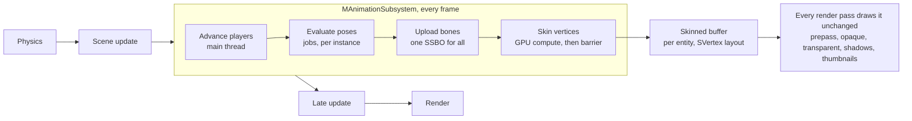

# Meteor Engine - Animation System v1 Design

## Overview

v1 adds skinned characters that play and crossfade clips from code or Lua, with bones evaluated on the CPU through `MJobSystem` and skinning done once per frame by a GPU compute shader. State machines come later and plug into the same playback core.

**In v1**

- `MSkeletalMeshAsset` and `MAnimClipAsset`, picked by one model importer, with a per-file `importAs` setting
- `MSkeletalMeshEntity`, a spatial entity alongside `MStaticMeshEntity`
- `MAnimationSubsystem`, which evaluates poses in parallel jobs
- Compute-shader skinning that outputs the existing `SVertex` layout, so no render stage or material shader changes
- `playClip(name, blendTime)` with crossfades, exposed to Lua
- Clips from other files, bound to a skeleton by bone name
- Editor support: import settings, Available Clips table, extra animation sources

**Not in v1:** state machines, root motion, additive blending and bone masks, IK, retargeting beyond name matching, clip compression, morph targets, animation events, animation LOD.

## Engine constraints

The design is shaped by how Meteor works today:

| Constraint | Where | Consequence for animation |
| --- | --- | --- |
| One asset per path; the first importer whose `canImport(ext)` succeeds wins | `MAssetManager::loadAsset` | One FBX is either a mesh or a clip asset. No sub-assets, so embedded clips can't have their own GUIDs. |
| A render item is a VAO + EBO + transform; each stage binds its own shader | `SRenderItem`, prepass / opaque / shadow / transparent stages | If skinning outputs a normal VAO, every stage draws skinned meshes unchanged. |
| Vertex inputs are fixed at locations 0–2 (position, normal, UV) | `meteor_vertex_utils.glsl`, `SVertex` | Vertex-shader skinning would need variants of every material, prepass and shadow shader. |
| OpenGL 4.6, SSBOs already in use | `windowing.cpp`, lighting / opaque stages | Compute shaders and SSBOs are available. |
| Applications drive the frame: physics, then `update`, then `lateUpdate`, then render | `MPlayerApplication`, editor `simulation_manager` | Animation is called explicitly between `update` and `lateUpdate`. |
| Jobs must not touch Lua, the scene, the asset manager or GL; tasks should be coarse | `job_system.h` | Clip lookups happen on the main thread; jobs only run pose maths on their own instances. |

## Import pipeline

One `MModelAssetImporter` replaces `MStaticMeshAssetImporter`'s extension check for gltf, glb, fbx and obj. It reads `importAs` from the `.meta` file and creates the matching asset class.

```xml
<meshImport>
  <importAs>Auto</importAs>   <!-- Auto | StaticMesh | SkeletalMesh | AnimationOnly -->
  <scaleFactor>0.01</scaleFactor>
  <pivot>FileOrigin</pivot>
  <maxBoneInfluences>4</maxBoneInfluences>
  <sampleRate>30</sampleRate>
</meshImport>
```

**Auto detection** runs once, on first import:

| Scene contents | Result |
| --- | --- |
| Meshes with bones | `MSkeletalMeshAsset` |
| No meshes, has animations | `MAnimClipAsset` |
| Anything else | `MStaticMeshAsset` |

The detected value is written back into the meta file, so later loads skip detection and the inspector shows it as a dropdown. Choosing StaticMesh for a rigged file imports it in bind pose with the bones ignored.

**Changing `importAs` changes the C++ class.** A reload destroys and recreates the asset. A `TAssetRef<MStaticMeshAsset>` pointing at a file that is now skeletal must resolve to null and log a warning, never cast. The editor can offer to swap the affected entities.

**Rules for skeletal import**

- Don't bake node transforms into skinned vertices; they stay in bind space.
- `scaleFactor` applies to vertex positions, bone translations, inverse-bind matrices and clip translation keys alike.
- `pivot` becomes a root offset rather than a vertex shift.
- Set `AI_CONFIG_IMPORT_FBX_PRESERVE_PIVOTS = false` to avoid `$AssimpFbx$` helper bones.
- Use `aiProcess_LimitBoneWeights` with `maxBoneInfluences` (4), then renormalize the weights.
- Use `aiProcess_CalcTangentSpace` if tangents are added to `SVertex` (see milestones).

**Resampling.** Every track is baked to evenly spaced keys at `sampleRate`, so sampling is `i = t × rate` plus a blend between two keys, with no search. That trades memory for simpler, cache-friendly job code; compression comes later.

## Data types

Clips are plain data shared by both asset types. A clip binds to any skeleton by bone name, so animation-only files work without a shared skeleton asset.

| Type | Kind | Holds |
| --- | --- | --- |
| `SSkeleton` | Data, owned by the mesh asset in v1 | Bones in parent-first order: name, parent index, inverse-bind matrix, bind pose position / rotation / scale |
| `SSkinnedVertex` | Vertex | `SVertex` + `uvec4 joints` + `vec4 weights` |
| `MSkeletalMesh` | GPU mesh | Shared, read-only buffers: bind-pose vertices, joints and weights, indices |
| `MAnimClip` | Data | Name, duration in seconds, sample rate, one track per bone keyed by bone name |
| `MSkeletalMeshAsset` | Asset | Meshes, the skeleton and its embedded clips |
| `MAnimClipAsset` | Asset | Every clip (take) in an animation-only file |
| `IAnimationClipSource` | Interface | `getClips()`, implemented by both asset types |

```cpp
class IAnimationClipSource {
public:
    virtual ~IAnimationClipSource() = default;
    virtual const std::vector<MAnimClip*>& getClips() const = 0;
};
```

**Binding by bone name.** The first time a clip is used on a skeleton, the engine builds a table mapping each clip track to a skeleton bone index. That table is cached per (clip, skeleton) pair. Tracks with no matching bone are ignored, and bones with no track stay in bind pose.

**Why an interface.** A file containing a mesh *and* animations imports as a skeletal mesh, but its clips should still be usable on other characters. Entity code only sees `IAnimationClipSource`, so either asset type can supply clips.

## MSkeletalMeshEntity

The entity mirrors `MStaticMeshEntity` and adds a list of animation sources. It builds one clip table from its mesh plus those sources.

**Saved fields**

| Field | Type | Notes |
| --- | --- | --- |
| `meshAsset` | `TAssetRef<MSkeletalMeshAsset>` | As on the static mesh entity |
| material slots | list | Shared code with `MStaticMeshEntity` (see below) |
| `castsShadow` | bool | |
| `animationSources` | ordered list of refs to an `MAnimClipAsset` or `MSkeletalMeshAsset` | Order matters for name conflicts |
| `defaultClip` | clip name | Kept even if the clip disappears; shown in red |
| `playOnStart`, `loop`, `speed` | bool, bool, float | |

Embedded clips are **never saved**. They are rebuilt from the mesh asset whenever it resolves, the same way material slots resize to the mesh count in `onDeserialise`. A re-exported FBX with a new clip then shows up without editing the scene.

**Pull out the material-slot code first.** Slot serialization, the legacy formats and resizing make up most of `staticmeshentity.cpp`. Move them into a shared helper or an `MMeshEntityBase` before writing the second entity.

**Building the clip table** (main thread, whenever the mesh or sources change)

1. Add the mesh asset's own clips.
2. Add each source's clips in list order. A later clip with the same name overrides the earlier one.
3. Skip duplicate sources, including the mesh's own asset added as a source.
4. Build or fetch the bone-name table for each clip and work out its status.

**Clip status**

| Status | When | Effect |
| --- | --- | --- |
| Available | All bones matched | Playable |
| Warning | Some bones matched (e.g. 52/55) | Playable. Normal for upper-body clips or skeletons with extra socket, IK or face bones. |
| Unavailable | No bones matched, or the skeleton's root bone has no track | Greyed out with the reason; not in Default Clip or `getClipNames()`; `playClip` logs the reason |
| Overridden | A later source has a clip with the same name | Greyed out, shows which source won |

**Bounds.** Camera and shadow culling both use `SRenderItem::bounds`, and a bind-pose AABB culls raised limbs. Each frame, use the AABB of the joint world positions plus padding; the jobs already compute those positions.

**Runtime data lives in the subsystem.** The entity holds a handle into `MAnimationSubsystem`'s instance pool. It registers on enter and unregisters on exit and destruction, like its render queue registration.

## MAnimationSubsystem

The subsystem runs once per frame **between `sceneManager->update` and `lateUpdate`**. A `playClip` from a script's `onUpdate` then takes effect in the same frame, and `lateUpdate` code (cameras, attached weapons) sees this frame's bones. Like physics, `canTick()` stays false and the applications call it directly: `MPlayerApplication` and the editor's `simulation_manager`.



Only the bone matrices cross from CPU to GPU each frame; the skinned buffer they produce is drawn by every pass.

**Each frame**

1. **Main thread:** advance clip times, update crossfade weights, resolve clip pointers and bone tables.
2. **Jobs (`MParallel::forEach` over instances):** sample each active clip, blend, walk bones parent-first to model space, multiply by inverse-bind to get skinning matrices, and compute the joint AABB. Each task writes only its own instance's slice.
3. **Main thread:** upload all skinning matrices with one `glBufferSubData` into a shared bone SSBO; each instance has an offset.
4. **Main thread:** dispatch skinning for every visible instance, then issue one barrier (next section).

Skinning runs **once per frame, not per view**, so the editor's scene view, game view and thumbnails all reuse the result.

**SAnimationPlayer** holds playback state: active entries (clip, time, weight, fade rate), speed and loop flag. It is a plain struct, not part of the entity. `playClip` drives it today; a state machine later becomes another driver of the same struct, with no change to jobs or skinning.

**Crossfades**

- Up to 3 active entries. `playClip` adds an entry whose weight rises from 0 to 1 over `blendTime`; the others fall proportionally.
- Entries at weight 0 are dropped. A fourth crossfade mid-blend drops the oldest.
- Positions and scales blend linearly. Rotations use normalized quaternion blending, with the sign flipped when the dot product is negative.
- `playClip` on the clip already playing is a no-op.

## GPU compute skinning

A compute shader skins each instance once per frame into its own buffer, laid out exactly as `SVertex`. That buffer sits behind a normal VAO, so the entity submits an ordinary `SRenderItem`. The prepass, opaque, transparent, shadow and thumbnail paths draw it with no new shaders.

**Buffers**

| Buffer | Owner | Access | Contents |
| --- | --- | --- | --- |
| Bind-pose vertices | `MSkeletalMesh` (shared) | read | 8 floats per vertex: position, normal, UV |
| Joints | `MSkeletalMesh` (shared) | read | `uvec4` per vertex |
| Weights | `MSkeletalMesh` (shared) | read | `vec4` per vertex |
| Bone matrices | `MAnimationSubsystem` (one for all) | read | Every instance's skinning matrices, uploaded each frame |
| Skinned vertices | Each entity | write, then draw | Same layout as `SVertex`; bound as an SSBO for the dispatch and as `GL_ARRAY_BUFFER` in the entity's VAO |

**Never skin in place.** The source must stay the bind pose; overwriting it would skin already-skinned vertices the next frame.

**Per entity, not per asset.** Two characters sharing a mesh have different poses, so each entity gets its own output buffer and VAO. Input buffers stay shared.

```glsl
#version 460
layout(local_size_x = 64) in;
layout(std430, binding = 0) readonly  buffer BindPose { float bindVerts[]; };   // 8 floats per vertex
layout(std430, binding = 1) readonly  buffer Joints   { uvec4 joints[]; };
layout(std430, binding = 2) readonly  buffer Weights  { vec4 weights[]; };
layout(std430, binding = 3) readonly  buffer Bones    { mat4 bones[]; };
layout(std430, binding = 4) writeonly buffer Out      { float outVerts[]; };
uniform uint u_vertexCount;
uniform uint u_boneOffset;   // this instance's slice of the bone buffer

void main() {
    uint v = gl_GlobalInvocationID.x;
    if (v >= u_vertexCount) return;
    uint b = v * 8;
    vec4 p = vec4(bindVerts[b], bindVerts[b+1], bindVerts[b+2], 1.0);
    vec3 n = vec3(bindVerts[b+3], bindVerts[b+4], bindVerts[b+5]);
    uvec4 j = joints[v]; vec4 w = weights[v];
    mat4 m = w.x * bones[u_boneOffset + j.x] + w.y * bones[u_boneOffset + j.y]
           + w.z * bones[u_boneOffset + j.z] + w.w * bones[u_boneOffset + j.w];
    vec3 sp = (m * p).xyz;
    vec3 sn = normalize(mat3(m) * n);
    outVerts[b]   = sp.x; outVerts[b+1] = sp.y; outVerts[b+2] = sp.z;
    outVerts[b+3] = sn.x; outVerts[b+4] = sn.y; outVerts[b+5] = sn.z;
    outVerts[b+6] = bindVerts[b+6]; outVerts[b+7] = bindVerts[b+7];   // UVs copied through
}
```

**Things to get right**

- **std430 alignment:** a `vec3` aligns to 16 bytes, but `SVertex` is a packed 32 bytes. Declare vertex buffers as `float[]` and index them by hand.
- **Barrier:** call `glMemoryBarrier(GL_VERTEX_ATTRIB_ARRAY_BARRIER_BIT)` once after all dispatches, before any stage draws.
- **Normals:** `mat3(m) * n` is only correct without non-uniform bone scale. That holds for nearly all character rigs.
- **Tangents:** if added to `SVertex`, skin them with the same `mat3(m)` and update the output stride at the same time.
- **Dispatch overhead:** start with one dispatch per instance, and batch every instance into one dispatch with an offset table if it shows up in profiling.

**CPU fallback.** Put skinning behind `ISkinningBackend`. A second implementation using `MJobSystem` writes the same output buffer, which makes a useful reference when the GPU output looks wrong.

**Expected performance.** These are rough estimates, not measurements: 20 characters × 30k vertices, drawn in about 8 passes (prepass, opaque, 3–4 shadow cascades, point-light faces).

| | CPU skinning (jobs) | Vertex-shader skinning | Compute skinning |
| --- | --- | --- | --- |
| CPU time | ~3–6 ms total, ~0.5–1 ms across 8 cores | ~0 | ~0 |
| Upload per frame | ~19 MB of vertices | ~20 KB of bones | ~20 KB of bones |
| Vertices skinned | 600k on the CPU | ~5M (every pass) | 600k (once) |
| Extra GPU time vs static meshes | upload / sync stalls | ~0.2–0.5 ms | ~0.1–0.2 ms |
| Extra VRAM | - | - | ~19 MB of output buffers |

Against CPU skinning, compute is a large win beyond a few characters. Against vertex-shader skinning, the frame-time gain is small and grows with shadow passes; the main gain is not needing skinned variants of every shader. Measure with a `GL_TIME_ELAPSED` timer query around the dispatches, reported through the profiler.

## Scripting API

Playback is exposed on `MSkeletalMeshEntity` with `SCRIPT_BIND_FUNC()` and forwards to its `SAnimationPlayer`.

```cpp
bool playClip(const SString& name, float blendTime = 0.2f, bool loop = true); // no-op if already playing
void stop(float blendTime = 0.2f);
void setSpeed(float speed);
bool isPlaying() const;
SString getCurrentClip() const;            // the entry with the highest weight
float getNormalizedTime() const;
void setNormalizedTime(float t);
bool hasClip(const SString& name) const;   // available clips only
std::vector<SString> getClipNames() const; // available clips only
SMatrix4 getBoneWorldTransform(const SString& boneName) const; // for sockets, valid from lateUpdate on
TDelegate<void(SString)> onClipFinished;   // non-looping clips
```

- `playClip` on an unavailable or unknown clip returns false and logs the same reason the inspector shows, for example: `Dance (Dance.fbx): no bones match Hero skeleton`.
- `getBoneWorldTransform` reads this frame's pose once the subsystem has run, so attachments belong in `lateUpdate`.

## Editor UX

The entity inspector reads top to bottom as cause and effect: pick the mesh, add sources, see the clips that result.

```text
Skeletal Mesh   [ Hero.fbx                 ]
Default Clip    [ Idle                    ▾]   available clips only

▾ Additional Animation Sources                  [+]   reorderable, later wins
    [ Locomotion.fbx ]                        [x]
    [ Dance.fbx      ]  ⚠ no clips usable      [x]

▾ Available Clips                                    read-only, collapsible
```

**Available Clips table**

| Clip | Source | Duration | Status |
| --- | --- | --- | --- |
| Idle | Hero.fbx (mesh) | 2.40 s | ✓ |
| Walk | Hero.fbx (mesh) | 1.10 s | overridden by Locomotion.fbx |
| Walk | Locomotion.fbx | 1.20 s | ✓ |
| Run | Locomotion.fbx | 0.80 s | ⚠ 52/55 bones matched |
| Dance | Dance.fbx | 4.00 s | ✗ no matching bones |

- Unavailable and overridden clips stay in the table, greyed out with the reason. Hiding them makes a missing clip look like a failed import.
- Sources accept `MAnimClipAsset` and `MSkeletalMeshAsset`, through `IAnimationClipSource`.
- A ▶ preview button per row can come later.

**Other editor work**

- Asset inspector for skeletal mesh and clip assets: `importAs`, scale, pivot, max influences, sample rate, and a read-only list of clips (name, duration, tracks).
- Skeleton debug drawing through `gizmos`.
- Clip preview outside simulation.
- Add Entity menu entry, and spawning an `MSkeletalMeshEntity` when a skeletal asset is dropped into the scene (`asset_drop_spawner`).
- A skeletal mesh inspector drawer alongside `static_mesh_inspector`.

## Milestones

Each milestone can be checked on its own before the next starts.

1. **Shared mesh-entity code:** move material-slot handling out of `MStaticMeshEntity`. Add the tangent to `SVertex` now if normal mapping is planned, so the vertex layout only changes once.
2. **Import:** `MModelAssetImporter`, `importAs` detection, skeleton, skinned vertices, resampled clips. Static meshes still import as before.
3. **Bind pose on screen:** entity, output buffer, VAO and compute dispatch with identity matrices. This proves the buffer and barrier path before any animation maths.
4. **Single-clip playback:** subsystem, jobs, bone upload, joint-based bounds.
5. **Crossfades and API:** `SAnimationPlayer`, `playClip`, Lua bindings, `onClipFinished`.
6. **Clip sources:** `MAnimClipAsset`, `IAnimationClipSource`, bone-name tables, clip status.
7. **Editor:** inspector layout, Available Clips table, asset inspector, skeleton gizmos, preview, drag-and-drop spawning.

## Deferred to later versions

State machines (as another driver of `SAnimationPlayer`), root motion, additive blending and bone masks, IK, retargeting beyond name matching, a shared skeleton asset, clip compression, morph targets, animation events, animation LOD and off-screen update throttling, single-dispatch batching of all instances.

## Open questions

- Should bone-name matching ignore common prefixes such as `mixamorig:`, or require exact names?
- Is 4 influences per vertex enough for the assets you plan to use, or should `maxBoneInfluences` allow 8?
- Should off-screen characters keep evaluating at full rate in v1, or pause until visible?
